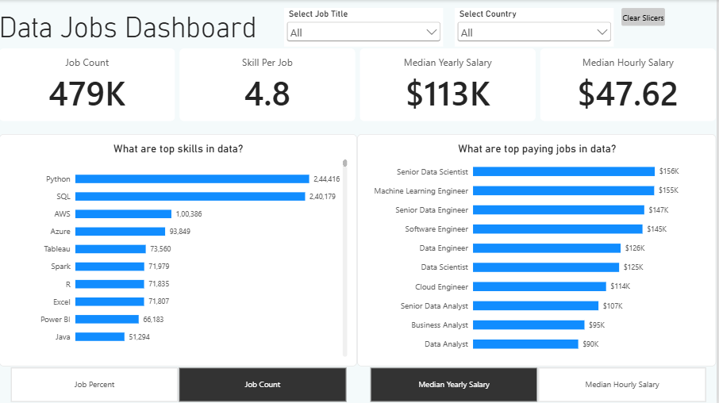

# Data Jobs Market Analysis Dashboard

An interactive Power BI dashboard analyzing data roles, market demand, top in-demand skills, and compensation trends across global job postings. Developed as a capstone project following Luke Barousse's Power BI course to implement end-to-end business intelligence workflows.

---

## 📊 Dashboard Overview



The dashboard provides a high-level view of the data job market, allowing users to slice by job title and geographic location to identify skill demand and salary distributions.

### Key Metrics Tracked (Global Baseline):

- **Total Job Postings:** 479K
- **Average Skills per Posting:** 4.8
- **Median Yearly Salary:** $113K
- **Median Hourly Salary:** $47.62/hr

---

## 🔑 Key Features & Questions Answered

1. **Top In-Demand Skills in Data:**
   - Visualizes the most frequently requested skills across postings (led by Python, SQL, AWS, and Azure).
   - Includes toggle options to switch between **Job Count** and **Job Percent**.

2. **Top-Paying Job Titles:**
   - Ranks roles by compensation, showing Senior Data Scientist ($156K) and Machine Learning Engineer ($155K) leading the segment.
   - Dynamic toggle controls for **Median Yearly Salary** vs. **Median Hourly Salary**.

3. **Interactive Slicers & State Resets:**
   - Dropdown filters for **Select Job Title** and **Select Country**.
   - Integrated **Clear Slicers** bookmark button to reset interactive filters to default view.

---

## 🛠️ Concepts & Skills Learned (through the course)

- **Data Transformation & Modeling:**
  - Cleaned, structured, and shaped semi-structured job posting datasets using Power Query.
  - Established relationships and schema structure for smooth cross-filtering.

- **DAX (Data Analysis Expressions):**
  - Built calculated measures for key performance indicators (KPI cards) such as Job Count, Average Skills Per Job, and Median Salaries.
  - Formatted metrics dynamically for clean user-facing representations (e.g., currency and standard number rounding).

- **Advanced Visualizations & UX:**
  - Implemented dynamic view switching using **Bookmarks** and **Selection Panes** for toggling between count/percent and yearly/hourly views.
  - Designed clean card visual layouts and bar charts with data labels for fast readability.
  - Added action buttons configured to clear all filters with a single click.

---

## 💻 Tech Stack & Tools

- **Business Intelligence Tool:** Microsoft Power BI Desktop
- **Data Processing:** Power Query (M Language)
- **Calculations:** DAX (Data Analysis Expressions)
- **Dataset Source:** Data Job Postings dataset from Luke Barousse's Power BI course

---

## 🚀 How to Run Locally

1. Clone or download this repository:

   ```bash
   git clone https://github.com/Harsh-Devv/Power-BI-Dashboard.git

   ```

2. Download and install Power BI Desktop.

3. Open the .pbix file located in the root folder.

Interact with the filters, buttons, and visual toggles directly in Power BI Desktop.
